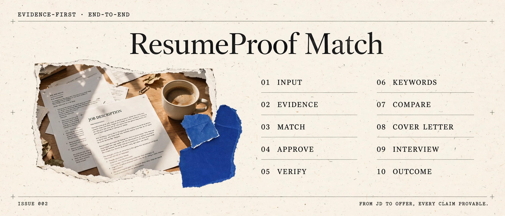

  

  <strong>Know the fit. Prove every claim. Approve before export.</strong>

  
  
  
  
  

  <a href="https://resumeproof.szw19990924.chatgpt.site/match/new?utm_source=github&amp;utm_medium=referral&amp;utm_campaign=skill_repo_202609"><strong>Try the live web app →</strong></a> ·
  <a href="README.zh-CN.md">中文</a> ·
  <a href="#install">Install</a> ·
  <a href="#how-it-works">How it works</a>

# ResumeProof Match

ResumeProof Match is an end-to-end Skill for AI agents that combines explainable resume–JD matching with evidence-backed resume production.

It answers two connected questions:

1. Is this role worth applying for, and why?
2. How do we turn the supported evidence into a tailored resume without inventing anything?

Most matching tools stop at a score. Most resume generators start writing before the facts are settled. ResumeProof Match keeps both stages in one auditable workflow.

## Try it in the browser

Want to use the workflow without installing a Skill first?

**[Match a resume to a JD on ResumeProof Match →](https://resumeproof.szw19990924.chatgpt.site/match/new?utm_source=github&utm_medium=referral&utm_campaign=skill_repo_202609)**

The web app lets you upload or paste both sources, review the extracted text, inspect requirement-level evidence, accept or edit suggestions, approve the full draft, and export HTML, PDF, or DOCX. You can also [load the complete example](https://resumeproof.szw19990924.chatgpt.site/match/new?demo=1&utm_source=github&utm_medium=referral&utm_campaign=skill_repo_202609) without uploading a file.

To understand the method before using the tool, read the [evidence-first resume matching guide](https://resumeproof.szw19990924.chatgpt.site/en/guide?utm_source=github&utm_medium=referral&utm_campaign=skill_repo_202609).

This repository is the AI-agent Skill and deterministic workflow. The interactive website is maintained separately in the [web app source repository](https://github.com/caihhhhhh/resumeproof-match-web).

## What makes it different

- **Requirement-level explanations** — every conclusion points to the original JD wording and specific resume evidence.
- **Three honest signals** — role fit, evidence coverage, and document readiness stay separate.
- **No fake ATS probability** — scores are decision aids, not claims about a recruiter's system.
- **Truth-aware edits** — suggestions are labeled supported, needs confirmation, or unsupported.
- **Mandatory text approval** — formatted files cannot be generated before the complete draft is approved.
- **Hash-bound QA and delivery** — changed text or regenerated files invalidate stale checks.
- **Portable and lightweight** — Python standard library only; no accounts, database, or vector store.

## Capabilities

- **Keyword coverage** — which JD terms your resume hits and which are missing. Facts only, no made-up pass probability.
- **Multi-JD comparison** — rank several applications side by side and decide where to apply first.
- **Cover letter track** — the same approval → QA → delivery pipeline for cover letters, sharing one evidence ledger with the resume.
- **Workspace export/import** — pack the whole workspace into a zip and continue on another machine with approvals intact.
- **Interview prep** — Q&A generated from the evidence ledger; every answer traces back to a claim ID.
- **Outcome tracking** — record what happened after delivery: applied, interview, offer, rejected.

## Install

\`\`\`bash
npx skills add caihhhhhh/resume-proof-match -g
\`\`\`

Then invoke it with a resume and complete JD:

> Use $resume-proof-match to compare my resume with this JD, show the evidence behind the fit, propose truthful edits, and wait for my full-text approval before generating files.

## How it works

\`\`\`text
Resume + JD + evidence
          ↓
JD requirements and hard gates
          ↓
Claim-to-source evidence ledger
          ↓
Explainable fit and gap report
          ↓
User-selected edits
          ↓
Complete text review and approval
          ↓
Formatted source + PDF
          ↓
QA-bound, versioned delivery
\`\`\`

The deterministic helper creates the workspace, validates cross-file references, calculates scores, records approval, binds QA to file hashes, and blocks unsafe delivery.

\`\`\`bash
python scripts/resume_proof_match.py new \
  --company "Example Co" \
  --role "Growth Analyst" \
  --language en

python scripts/resume_proof_match.py score Resume_Output/Applications/<folder> --write
python scripts/resume_proof_match.py keywords Resume_Output/Applications/<folder> --resume resume.pdf
python scripts/resume_proof_match.py compare Resume_Output/Applications/<folder-a> Resume_Output/Applications/<folder-b>
python scripts/resume_proof_match.py cover-approve Resume_Output/Applications/<folder>
python scripts/resume_proof_match.py cover-qa Resume_Output/Applications/<folder> --file cover-letter.pdf --text passed --facts passed
python scripts/resume_proof_match.py export Resume_Output/Applications/<folder> --output app.zip
python scripts/resume_proof_match.py interview Resume_Output/Applications/<folder> --output interview-prep.md
python scripts/resume_proof_match.py status Resume_Output/Applications/<folder>
python scripts/resume_proof_match.py outcome Resume_Output/Applications/<folder> --status applied
python scripts/resume_proof_match.py approve Resume_Output/Applications/<folder>
python scripts/resume_proof_match.py inspect resume.pdf --max-pages 2
python scripts/resume_proof_match.py qa Resume_Output/Applications/<folder> \
  --file resume.pdf --text passed --facts passed --pagination passed --visual passed
python scripts/resume_proof_match.py deliver Resume_Output/Applications/<folder> \
  --file resume.pdf --delivery-dir Resume_Output/Delivery
\`\`\`

The agent performs semantic analysis and writing. The CLI enforces deterministic state, references, scoring, approval, and delivery rules. The core uses Python's standard library; PDF text inspection additionally uses \`pypdf\` or \`pdftotext\` when available.

## Scoring without double counting

Requirements are classified as must-have, nice-to-have, or must-not. Positive requirements are weighted by their stated importance; must-haves receive additional weight. Supported, needs-confirmation, and unsupported mappings receive deterministic factors.

Resume presentation quality is reported separately, so polished formatting cannot hide a missing qualification. See [the matching model](references/matching.md) for the complete contract.

## Repository layout

\`\`\`text
resume-proof-match/
├── SKILL.md
├── agents/openai.yaml
├── scripts/resume_proof_match.py
├── references/
│   ├── matching.md
│   ├── delivery.md
│   └── workspace-exchange.md
├── examples/sample-application/
├── tests/
├── .github/workflows/ci.yml
├── CHANGELOG.md
└── AGENSI_LISTING.md
\`\`\`

## Privacy and safety

Keep populated resumes, evidence ledgers, and application workspaces outside this repository. The included safety command scans public files for obvious personal paths, contact details, phone numbers, and tokens:

\`\`\`bash
python scripts/resume_proof_match.py safety .
\`\`\`

ResumeProof Match never authorizes applying, uploading, publishing, emailing, or copying files to Desktop. Those remain explicit user actions.

## Frequently asked questions

### Is this an ATS scoring tool?

No. ResumeProof Match checks practical, verifiable properties — extractable text,
page limits, required terms, readable structure — and reports three separate
decision-aid signals. It never presents a score as an ATS pass probability.

### How is this different from the free `resume-proof` skill?

[`resume-proof`](https://github.com/caihhhhhh/resume-proof) is the free,
governance-only layer: claim tracing, approval gates, and QA around resume work.
This Match edition adds the full end-to-end workflow — JD requirement extraction,
explainable fit scoring, and a live web demo — in one auditable pipeline.

### Does it write the resume for me?

A compatible AI agent does the analysis and writing; the skill governs it. Every
claim stays tied to supplied evidence, and formatted files are blocked until you
approve the complete text draft.

### Does it handle Chinese resumes?

Yes. Workspaces accept a target language (`en`, `zh`, or `bilingual`), and the
workflow rewrites naturally for the target language instead of translating line
by line.

### Where does my data go?

Nowhere. The CLI runs locally with the Python standard library — no accounts, no
database, no network calls. Keep populated workspaces outside the public repository.

## Development

\`\`\`bash
python -m unittest discover -s tests -v
python scripts/resume_proof_match.py safety .
\`\`\`

Licensed under the [MIT License](LICENSE).
